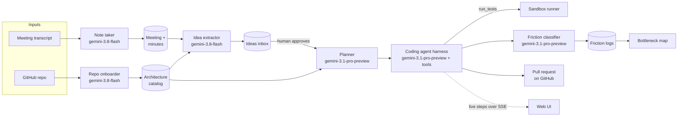
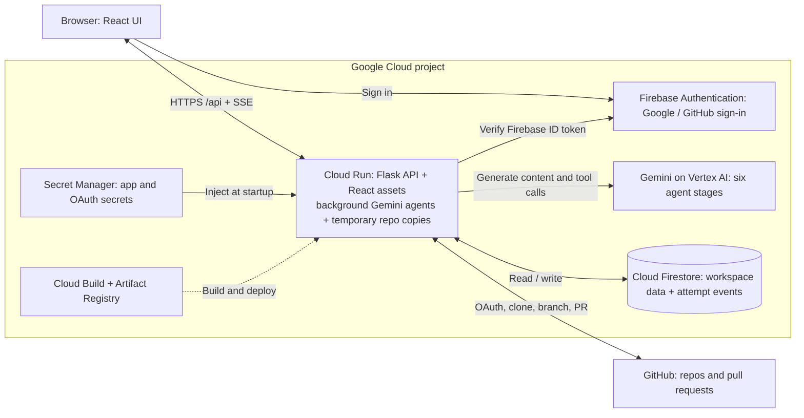

# tryout

**[Open the live demo](https://tryout-git-bhhkaqw34q-ww.a.run.app/)** · [Watch the demo video](https://drive.google.com/file/d/1t5WZJp3t0B_wmFV8VAsS_C8FAbaCPmpd/view) · [For judges](#for-judges)

**Meeting ideas, shipped as reviewed pull requests.**

tryout reads your meeting transcripts, pulls out the ideas worth acting on, and has Gemini agents *attempt* each approved idea against your real codebase. A completed attempt produces a prototype patch, a pull request when publication succeeds, and a **friction log**: each blocker the agent hit (a missing credential, another team's API, a schema change, an undecided product question), who owns it, and what has to happen to unblock it. Across many attempts, those logs add up to a **bottleneck map** of your organization.

**Demo data is synthetic:** Acme Store, its meeting participants, teams, transactions and seeded friction history are fictional. [hamzam1997/acme-store](https://github.com/hamzam1997/acme-store) deliberately omits integrations so attempts can reveal blockers. The final video demonstrates a separate Slack notification idea against tryout itself; the judge walkthrough below uses the bundled Acme Store fixture.

---

## Contents

- [The problem](#the-problem)
- [What tryout does](#what-tryout-does)
- [For judges](#for-judges)
- [How it works](#how-it-works)
- [Where Gemini is used](#where-gemini-is-used)
- [Architecture](#architecture)
- [Workspaces, auth and roles](#workspaces-auth-and-roles)
- [API reference](#api-reference)
- [Running locally](#running-locally)
- [Configuration](#configuration)
- [Deploying to Cloud Run](#deploying-to-cloud-run)
- [Safety, limitations and roadmap](#safety-limitations-and-roadmap)
- [Team](#team)

---

## The problem

Teams generate ideas in meetings constantly, and most never get acted on. The ones that do often run into blockers weeks into execution: a permission nobody has, a data field that doesn't exist, a dependency on another team's backlog, a decision nobody made. By then the time is already spent.

Meeting tools (Otter, Fireflies, Granola) summarize conversations and list action items. Planning tools estimate work from what people type into them. **Neither one tries the work.** So blockers are *predicted*, or discovered late, instead of *observed* early.

tryout moves that discovery to right after the meeting, while an idea is still cheap to reshape, reprioritize or drop. Engineers spend time only on ideas whose path to shipping is understood, and leaders get evidence of which teams, systems and approval steps slow the organization down.

### Example

In a weekly ops meeting, a manager suggests notifying customers automatically when a refund is delayed. tryout extracts the idea with the exact quote and timestamp, and a teammate approves it. The agent plans the change against the store's architecture, writes the code, and finds that:

1. refund status lives in the payments code, but nothing records *why* a refund is delayed (a schema change owned by `@team-payments`), and
2. sending notifications needs `notifications-service`, owned by `@team-comms`, which this repo can't reach.

It mocks the notification client, gets the tests passing, and opens a pull request. By the next meeting the team has a working partial prototype and a checklist of exactly two blockers, each with an owner.

---

## What tryout does

| Stage | Input | Output |
|---|---|---|
| **1. Onboard a repo** | A GitHub repository | An **architecture catalog**: modules, routes, models, integrations, config, owners from `CODEOWNERS`, test command |
| **2. Ingest a meeting** | A `.vtt` / `.srt` / `.txt` transcript (Meet, Zoom and Teams export these) | Minutes: summary, key points, action items |
| **3. Extract ideas** | Transcript + catalog | Catalog-grounded proposals with speaker, quote, timestamp, priority and an attempt hypothesis, deduplicated across meetings |
| **4. Approve** | One click by a person | The human gate: nothing runs without it |
| **5. Plan** | Idea + catalog + meeting evidence | A technical plan: in-repo changes kept separate from external requirements, plus a mock strategy |
| **6. Build** | Plan + temporary copy of the repo | A coding agent edits files and runs tests over up to 40 tool-calling steps, streamed live to the UI |
| **7. Log friction** | The diff + test notes | Structured blockers: category, service, owning team, mock used, required action, readiness checklist |
| **8. Publish** | Workspace changes | A pull request on `tryout/idea-<id>-attempt-<id>` with the readiness checklist in its description |
| **9. Bottleneck map** | Every friction log in the workspace | Blockers ranked by category, service and team, plus an estimate of engineering weeks saved |

---

## For judges

Open the [live demo](https://tryout-git-bhhkaqw34q-ww.a.run.app/) and click **Continue as evaluator**. No Google or GitHub account is required. Each evaluator sign-in creates a fresh, empty workspace; stay in that session to keep following your run. Allow **5–10 minutes** for the full flow; the video compresses the waits. The five-step tour points to the next action.

1. **Map the repository:** Repositories → **Demo repository** → **Connect demo repository**. Wait for the catalog to be ready, then click **View catalog**. Expect modules, routes, models, integrations and owners from `CODEOWNERS`.
2. **Read the meeting:** Meetings → **Load demo transcript**. This loads [`fixtures/meetings/2026-09-17-weekly-ops.vtt`](fixtures/meetings/2026-09-17-weekly-ops.vtt); uploading that same file through the upload control is equivalent. Wait for minutes and idea extraction to finish. Expand the meeting to inspect the summary, speakers and proposals. The main proposal is to email customers when a refund is delayed.
3. **Approve one idea:** Ideas → **Needs approval** → open the refund notification proposal. Inspect its speaker, quote, timestamp and attempt plan, select **acme-store** if prompted, then click **Approve**. Approval starts the attempt immediately. **Watch live** shows planning, file reads and edits, test commands and recorded friction; it can be closed and reopened while the attempt runs.
4. **Review the prototype:** Ideas → **Done** → open the idea → **View report**. Inspect **Production readiness**, **Test results**, **Mock adapters** and **Code change**. Likely blockers include notification-service access, missing refund data and the undecided delay threshold. **View pull request** opens the generated GitHub PR, with its readiness checklist. The deployed demo can publish to Acme Store using a server-side token; your own repos need a GitHub connection with write access. Review and merge remain human actions.
5. **Inspect the bottleneck map:** Open **Bottleneck map**, then click a category, service or team bar to filter its friction log. A fresh evaluator starts with no historical data: this map fills from your attempts. A normal first-time Google/GitHub account may include synthetic history when `SEED_DEMO_DATA=1`.

Model output varies: titles, timings, files changed and blocker counts are not fixed. An attempt can finish with failing or unrun tests, no blockers, or a saved patch without a hosted PR. Read the actual report before judging readiness; a completed attempt does not mean production-ready code.

If a stage fails: use **Retry analysis** on the repository card, retry idea extraction on the meeting, or **Retry attempt** under Ideas → **In process**. If the repository's `main` branch moved, refresh its catalog before retrying. A missing PR link means publication did not succeed; the report retains the patch and error. Onboarding a repo before loading the transcript gives extraction the catalog it needs.

---

## How it works



### 1. Repository onboarding: `agents/repo_onboarder.py`, `repo_scanner/`

`repo_scanner` walks the repository, classifies files (manifests, config, models, routes, integrations, entrypoints, docs) and builds a compact skeleton that fits a long-context prompt. Gemini turns it into a structured `ArchitectureCatalog` (`schemas.py`): language, framework, entrypoint, test command, modules, key files, internal models, API routes, external integrations, config keys, `CODEOWNERS` ownership and coding guidelines. The catalog is cached against the commit it was built from, and attempts refuse to run if the repository has moved on since, so ideas are always grounded in the code they will run against.

### 2. Meeting ingestion: `agents/transcript.py`, `agents/note_taker.py`

Transcripts are parsed into one normalized form (WebVTT voice spans, SRT cues or plain `Speaker: text` lines), keeping speakers and timestamps. The meeting is saved *before* any model call, so a Gemini failure costs a retry, not the upload. The note taker writes minutes: a summary, key points and action items.

### 3. Idea extraction: `agents/idea_extractor.py`

Gemini reads the transcript alongside each onboarded repository's catalog and separates real proposals from status updates and general discussion. Each idea carries its evidence (speaker, quote, cue time), a priority, the catalog touchpoints it affects, and an *attempt hypothesis*. A stable kebab-case `idea_key` deduplicates the same proposal raised again in a later meeting. Ideas land in the inbox as **Pending**: a person decides what is worth attempting.

### 4. Planning: `agents/planner.py`

On approval, the planner (`MODEL_PLANNING`, structured output) produces a `TechnicalPlan` that keeps two kinds of work strictly apart:

- `repo_changes`: ordered files to create or modify *inside* this repository
- `external_requirements`: every service, credential or other team's system the idea needs that this repo doesn't own, plus a `mock_strategy` for each, so the prototype and its tests run without real credentials

### 5. The coding agent: `agents/harness/`, `agents/attempt_jobs.py`

Each attempt works on a throwaway copy of the repository at the catalogued commit; files that look like secrets (`.pem`, `.key`, `credentials.json`, …) are left out of the copy. The harness runs a Gemini function-calling loop (up to 40 steps) with these tools:

| Tool | What it does |
|---|---|
| `search_code` | grep the workspace |
| `list_directory` / `view_file` | read the code (paths are confined to the workspace) |
| `edit_file` / `create_file` | change the code |
| `run_tests` | run a command in the sandbox runner (`runner/sandbox.py`): time, CPU and file-size limits, a minimal environment with no server secrets, and the whole process group killed on timeout |
| `complete_attempt` | finish with a summary, PR title and testing notes |

Every step is written to the attempt record as it happens. The UI's live view follows it over server-sent events (`/api/attempts/<id>/stream`), which read from the database so they work no matter which instance runs the attempt. An attempt that goes silent for 15 minutes (its worker died) is marked failed so it can be retried.

### 6. Friction classification: `agents/friction_classifier.py`

After the run, Gemini reviews the diff and the agent's testing notes and records each blocker as a structured `FrictionLog`:

| Category | Meaning | Est. weeks if found late |
|---|---|---|
| `EXTERNAL_SERVICE_DEPENDENCY` | Needs a service or API this repo doesn't own | 2.0 |
| `AUTH_CREDENTIAL_REQUIRED` | Needs a key, scope or access grant | 1.0 |
| `SCHEMA_MIGRATION_REQUIRED` | Needs a data model or schema change | 1.5 |
| `CROSS_TEAM_CONTRACT` | Needs another team to change or agree on an interface | 2.0 |
| `PRODUCT_DECISION` | Needs a human decision nobody has made yet | 1.0 |

Each log names the service, the owning team (from the catalog's `CODEOWNERS`), the mock that stood in for it, the action needed, and a readiness checklist with an owner per task. Classification failures never break an attempt.

### 7. Pull request: `agents/github_pr.py`

With a workspace/user GitHub connection (or the demo token for Acme Store), tryout commits the changes to `tryout/idea-<id>-attempt-<id>` and opens a pull request against `main`. The PR description carries the agent's summary and the readiness checklist. Without a GitHub connection, the patch stays on the report page.

### 8. Bottleneck map: `views/bottlenecks.py`, `frontend/src/pages/BottlenecksPage.jsx`

All friction logs in a workspace, aggregated by category, service and owning team, with the full log below. The "engineering weeks saved" figure applies the per-category weights above. It's an estimate of what each blocker costs when found mid-sprint instead of on day 0, and the UI labels it as one.

---

## Where Gemini is used

All model calls use the Google Gen AI SDK with `vertexai=True`, Application Default Credentials and the configured project/location in [`llm.py`](llm.py). Flash handles repository mapping and transcript extraction; Pro handles planning, coding and friction analysis. These are the defaults in [`config.py`](config.py), not a claim about every deployed revision. Each stage can be overridden through its environment variable; choose models available to your Vertex AI project and location. No Gemini API key is required.

| Stage | Default model | Technique |
|---|---|---|
| Repo onboarding | `gemini-3.8-flash` (`MODEL_ONBOARDING`) | Long-context repo skeleton → JSON schema (`ArchitectureCatalog`) |
| Meeting minutes | `gemini-3.8-flash` (`MODEL_EXTRACTION`) | Structured output (`MeetingMinutes`) |
| Idea extraction | `gemini-3.8-flash` (`MODEL_EXTRACTION`) | Full transcript + catalog → structured candidates with evidence |
| Planning | `gemini-3.1-pro-preview` (`MODEL_PLANNING`) | Structured output (`TechnicalPlan`) grounded in catalog + meeting |
| Coding agent | `gemini-3.1-pro-preview` (`MODEL_CODING`) | Multi-turn function calling over 7 tools (including completion) |
| Friction classification | `gemini-3.1-pro-preview` (`MODEL_PLANNING`) | Diff + testing notes → structured blockers |

---

## Architecture



**Why these services:** Gemini on **Vertex AI** provides structured outputs for catalogs, minutes, ideas, plans and friction, plus tool calls for coding, through one authenticated client. **Cloud Firestore** persists workspace-scoped records and live attempt events across Cloud Run instances. **Firebase Authentication** handles Google/GitHub identity; the API verifies ID tokens before issuing its session cookie. **Cloud Run** serves the API and built React UI from one container, with CPU available after requests return so background agents can continue. The runtime service account uses Application Default Credentials for Google APIs; no service-account key is baked into the image.

| Layer | Technology | Where |
|---|---|---|
| Web UI | React 19 + Vite, URL routing, Firebase Auth client | `frontend/` |
| API | Flask 3, JSON routes under `/api`, served by gunicorn | `app.py`, `views/` |
| Agents | Gemini via `google-genai` on Vertex AI | `agents/`, `llm.py` |
| Sandbox | Subprocess runner with resource limits | `runner/sandbox.py` |
| Data | Cloud Firestore, repositories, meetings, ideas, attempts and friction scoped to a workspace | `database/` |
| Auth | Firebase Auth (Google, GitHub), server-verified ID tokens, Flask session cookie | `views/auth.py` |
| Hosting | Cloud Run (one container serves the API and the built UI), Cloud Build deploys on push to `main` | `Dockerfile` |

Background work (minutes, idea extraction, onboarding, attempts) runs in worker threads started by the request, so the API returns immediately and the UI polls only the page you are on while that page's jobs are running.

```
├── app.py                 Flask app: blueprints, auth gate, serves frontend/dist
├── config.py              Settings from env / .env (pydantic-settings)
├── llm.py                 Shared Vertex AI client
├── schemas.py             Pydantic models: catalog, meeting, idea, plan, attempt, friction, workspace
├── agents/
│   ├── repo_onboarder.py  Architecture catalog generation
│   ├── transcript.py      .vtt / .srt / text parsing
│   ├── note_taker.py      Minutes
│   ├── idea_extractor.py  Catalog-grounded idea extraction
│   ├── planner.py         Technical plan
│   ├── harness/           Coding agent loop + tools
│   ├── attempt_jobs.py    Attempt pipeline: copy → plan → code → friction → PR
│   ├── friction_classifier.py
│   ├── github_pr.py       Branch, commit, push, open PR
│   └── git_utils.py       Clone / tarball fetch with commit pinning
├── repo_scanner/          File traversal and classification for onboarding
├── runner/sandbox.py      Limited command execution
├── database/              Firestore repositories, workspace scoping, locks, token encryption
├── views/                 HTTP API
├── seed_history.py        Demo history for new workspaces (SEED_DEMO_DATA=1)
├── demo_repo/acme_store/  Source of the fictional demo repo
├── fixtures/meetings/     Sample transcripts
├── frontend/              React app
└── tests/                 unittest suite
```

---

## Workspaces, auth and roles

- **Sign-in:** Google or GitHub through Firebase Auth; optional evaluator sign-in creates a throwaway identity directly on the server. The browser sends the Firebase ID token to `/api/auth/firebase-sync`, the server verifies it with the Firebase Admin SDK and starts a session. Protected `/api` routes require that session; evaluator login and auth bootstrap routes are public.
- **Workspaces:** all data (repositories, meetings, ideas, attempts, friction) belongs to a workspace, and every read and write is scoped to the caller's current workspace. Each user gets a personal workspace on first sign-in and can create, rename, switch between and delete workspaces.
- **Roles:** owner, admin and member. Members read, approve, reject and run attempts. Changing what a workspace works on (repositories, meetings) and deleting ideas needs an admin or owner.
- **Invitations:** admins create invite links. Accepting one adds you to the workspace.
- **GitHub connection:** one per workspace. The token is encrypted at rest (Fernet, key derived from `SECRET_KEY`) and used for private-repo cloning and pull requests.

---

## API reference

All routes are JSON under `/api`. Everything except the auth bootstrap routes requires a signed-in session.

| Area | Routes |
|---|---|
| Auth | `POST /auth/evaluator` · `GET /auth/firebase-config` · `POST /auth/firebase-sync` · `GET /auth/me` · `POST /auth/logout` · `GET /auth/github/login` · `GET /auth/github/callback` · `GET /auth/github/status` · `GET /auth/github/repos` · `POST /auth/github/logout` |
| Repositories | `GET /repositories` · `POST /repositories/onboard` · `GET /repositories/<id>` · `GET /repositories/<id>/catalog` · `DELETE /repositories/<id>` |
| Meetings | `GET /meetings` · `POST /meetings/upload` · `POST /meetings/demo` · `GET /meetings/<id>` · `POST /meetings/<id>/extract-ideas` · `DELETE /meetings/<id>` |
| Ideas | `GET /ideas?status=` · `GET /ideas/counts` · `GET /ideas/<id>` · `POST /ideas/<id>/approve` · `POST /ideas/<id>/attempts/retry` · `POST /ideas/<id>/reject` · `DELETE /ideas/<id>` |
| Attempts | `GET /attempts/<id>` (report incl. friction) · `GET /attempts/<id>/stream` (server-sent events) |
| Bottlenecks | `GET /bottlenecks` |
| Workspaces | `GET, POST /workspaces` · `PATCH, DELETE /workspaces/<id>` · `POST /workspaces/<id>/switch` · `GET /workspaces/<id>/members` · `PATCH, DELETE /workspaces/<id>/members/<uid>` · `GET, DELETE /workspaces/<id>/github` |
| Invitations | `GET, POST /workspaces/<id>/invitations` · `DELETE /workspaces/<id>/invitations/<token>` · `GET /invitations/<token>` · `POST /invitations/<token>/accept` |

`GET /health` (outside `/api`) reports liveness and whether the built UI is present.

---

## Running locally

Requirements: Python 3.12, Node 22, git, the Google Cloud CLI (`gcloud`), and a Google Cloud project with Vertex AI and Firestore enabled.

```bash
cp .env.example .env            # set GOOGLE_CLOUD_PROJECT, SECRET_KEY and FIREBASE_* (see Configuration)
python -m venv venv && source venv/bin/activate
pip install -r requirements.txt
gcloud auth application-default login
```

Run the API and the UI in two terminals:

```bash
python app.py                   # API on http://localhost:8080
```

```bash
cd frontend && npm ci && npm run dev    # UI on http://localhost:5173, proxies /api and /health to Flask
```

Open http://localhost:5173 and sign in (add `localhost` to Firebase Authentication → Authorized domains if it is missing). With `FLASK_DEBUG=1`, failure to initialize Firestore can fall back to an in-memory store; that data is lost on restart. Production fails instead of silently falling back. For a local demo without Firebase sign-in, set `EVALUATOR_LOGIN=1`.

### Tests

```bash
SECRET_KEY=test python -m unittest discover -s tests
```

```bash
cd frontend && npm ci && npm run lint && npm test && npm run build
```

### Production-shaped image

The Dockerfile builds the React app in a Node stage and serves it from Flask with gunicorn. On Apple Silicon, build for Cloud Run's architecture:

```bash
docker build --platform linux/amd64 -t tryout .
```

```bash
docker run --rm -p 8080:8080 --env-file .env tryout
```

---

## Configuration

Settings are read from the environment, or from `.env` locally (`config.py`).

| Variable | Default | Purpose |
|---|---|---|
| `GOOGLE_CLOUD_PROJECT` | (none) | Project for Vertex AI. Required for every agent stage |
| `GOOGLE_CLOUD_LOCATION` | `global` | Vertex AI endpoint location; model availability depends on project/location |
| `FIRESTORE_DATABASE` | `(default)` | Firestore database id |
| `MODEL_ONBOARDING` | `gemini-3.8-flash` | Architecture catalog |
| `MODEL_EXTRACTION` | `gemini-3.8-flash` | Minutes and idea extraction |
| `MODEL_PLANNING` | `gemini-3.1-pro-preview` | Planner and friction classifier |
| `MODEL_CODING` | `gemini-3.1-pro-preview` | Coding agent |
| `EXECUTION_TIMEOUT_SECONDS` | `60` | Per-command limit for sandbox runs and clones |
| `SEED_DEMO_DATA` | `0` | `1` seeds demo history into each new workspace (not evaluator workspaces, which start empty) |
| `EVALUATOR_LOGIN` | `0` | `1` offers "Continue as evaluator": a new throwaway evaluator and empty workspace per click, no Google or GitHub account |
| `DEMO_GITHUB_TOKEN` | (none) | GitHub token limited to the demo repo; lets attempts by users without GitHub open real pull requests there |
| `SECRET_KEY` | (none) | Session signing and the GitHub-token encryption key. **Required**: the app refuses to start without it unless `FLASK_DEBUG=1`, which uses a random per-run key |
| `GITHUB_CLIENT_ID` / `GITHUB_CLIENT_SECRET` | (none) | GitHub OAuth app for connecting repositories |
| `GITHUB_REDIRECT_URI` | derived from request | OAuth callback override |
| `FIREBASE_API_KEY`, `FIREBASE_AUTH_DOMAIN`, `FIREBASE_PROJECT_ID`, `FIREBASE_STORAGE_BUCKET`, `FIREBASE_MESSAGING_SENDER_ID`, `FIREBASE_APP_ID` | (none) | Firebase web config served to the UI (public by design, but not committed). `FIREBASE_PROJECT_ID` falls back to `GOOGLE_CLOUD_PROJECT` |
| `PORT` | `8080` | HTTP port |
| `FLASK_DEBUG` | `0` | Debug mode; also turns off secure-only cookies for local HTTP |

Seed an existing workspace by hand with `python seed_history.py <workspace_id>`.

---

## Deploying to Cloud Run

The demo uses service `tryout-git` in `me-central1`. The commands below provision a separate deployment from this checkout; they do not configure a GitHub push trigger. The demo's Cloud Build trigger is managed outside this repository.

### 1. Prepare the project and runtime identity

Use a billing-enabled Google Cloud project. A project administrator must enable the APIs, create the Firestore database and grant the roles below. The deployer needs `roles/run.sourceDeveloper`, `roles/serviceusage.serviceUsageConsumer`, and `roles/iam.serviceAccountUser` on the runtime identity; making the service public also requires permission to change its IAM policy. See [source deployment permissions](https://docs.cloud.google.com/run/docs/deploying-source-code).

```bash
export TRYOUT_PROJECT="your-project-id"
export TRYOUT_REGION="me-central1"
export TRYOUT_SERVICE="tryout"
export TRYOUT_RUNTIME_SA="tryout-runtime@${TRYOUT_PROJECT}.iam.gserviceaccount.com"
gcloud config set project "$TRYOUT_PROJECT"
gcloud services enable run.googleapis.com cloudbuild.googleapis.com \
  artifactregistry.googleapis.com aiplatform.googleapis.com \
  firestore.googleapis.com secretmanager.googleapis.com identitytoolkit.googleapis.com
gcloud iam service-accounts create tryout-runtime --display-name="tryout runtime"

# Skip database creation if this project already has a (default) database.
gcloud firestore databases create --database='(default)' \
  --location="$TRYOUT_REGION" --type=firestore-native

for TRYOUT_ROLE in roles/aiplatform.user roles/datastore.user; do
  gcloud projects add-iam-policy-binding "$TRYOUT_PROJECT" \
    --member="serviceAccount:$TRYOUT_RUNTIME_SA" --role="$TRYOUT_ROLE"
done

# Source builds use the project's default Cloud Build service account.
# If your organization overrides it, grant run.builder to that build identity instead.
TRYOUT_BUILD_SA="$(gcloud builds get-default-service-account \
  --project="$TRYOUT_PROJECT" --format='value(serviceAccountEmail)')"
TRYOUT_BUILD_SA="${TRYOUT_BUILD_SA##*/}"
gcloud projects add-iam-policy-binding "$TRYOUT_PROJECT" \
  --member="serviceAccount:$TRYOUT_BUILD_SA" --role=roles/run.builder
```

The **runtime** identity gets Vertex AI User (`roles/aiplatform.user`) and Cloud Datastore User (`roles/datastore.user`) for Firestore reads/writes. Give it Secret Manager Secret Accessor (`roles/secretmanager.secretAccessor`) on each secret it needs, as below. Build/deployer permissions belong to their own identities.

### 2. Configure sign-in, secrets and environment

In the Firebase console, add this Google Cloud project, register a web app and enable Google/GitHub sign-in providers. For GitHub sign-in, follow Firebase's provider setup and use its displayed auth-handler callback. The app's separate GitHub repository connection uses a GitHub OAuth app with callback `https://SERVICE_URL/api/auth/github/callback`; set it after the first deployment.

Create Secret Manager secrets named `tryout-secret-key`, `tryout-github-client-id`, `tryout-github-client-secret`, and, for evaluator PR publication, `tryout-demo-github-token`. Add a version containing each value through the console or `gcloud secrets versions add --data-file=...`. Generate `SECRET_KEY` with `python -c 'import secrets; print(secrets.token_hex(32))'`. Keep it stable across revisions: changing it invalidates sessions and prevents decrypting existing GitHub tokens. Limit the demo token to Acme Store with **Contents: write** and **Pull requests: write**.

```bash
for TRYOUT_SECRET in tryout-secret-key tryout-github-client-id \
  tryout-github-client-secret tryout-demo-github-token; do
  gcloud secrets add-iam-policy-binding "$TRYOUT_SECRET" \
    --member="serviceAccount:$TRYOUT_RUNTIME_SA" \
    --role=roles/secretmanager.secretAccessor
done
```

Create a local `cloud-run.env.yaml` (excluded from source uploads) with the public Firebase web config from Project settings → Your apps. Use quoted strings for Cloud Run environment values:

```yaml
GOOGLE_CLOUD_PROJECT: "your-project-id"
GOOGLE_CLOUD_LOCATION: "global"
FIRESTORE_DATABASE: "(default)"
FLASK_DEBUG: "0"
MODEL_ONBOARDING: "gemini-3.8-flash"
MODEL_EXTRACTION: "gemini-3.8-flash"
MODEL_PLANNING: "gemini-3.1-pro-preview"
MODEL_CODING: "gemini-3.1-pro-preview"
EXECUTION_TIMEOUT_SECONDS: "60"
EVALUATOR_LOGIN: "1"
SEED_DEMO_DATA: "1"
FIREBASE_API_KEY: "your-public-web-api-key"
FIREBASE_AUTH_DOMAIN: "your-project-id.firebaseapp.com"
FIREBASE_PROJECT_ID: "your-project-id"
FIREBASE_STORAGE_BUCKET: "your-project-id.firebasestorage.app"
FIREBASE_MESSAGING_SENDER_ID: "your-sender-id"
FIREBASE_APP_ID: "your-web-app-id"
```

Evaluator login and synthetic history are optional demo settings. For a deployment without them, set both flags to `"0"`, omit the demo token secret/binding, and remove `DEMO_GITHUB_TOKEN` from the command below. Google/GitHub users can still connect their own repositories.

### 3. Build and deploy

Run from the repository root. `--source .` uses the existing multi-stage Dockerfile through Cloud Build and stores the image in Artifact Registry. `.gcloudignore` excludes local secrets, environments and demo recordings from uploads; `.dockerignore` excludes them from the image.

```bash
gcloud run deploy "$TRYOUT_SERVICE" \
  --project="$TRYOUT_PROJECT" --region="$TRYOUT_REGION" \
  --source . --service-account="$TRYOUT_RUNTIME_SA" \
  --allow-unauthenticated --port=8080 \
  --cpu=1 --memory=1Gi --no-cpu-throttling \
  --min-instances=1 --max-instances=3 --timeout=300 \
  --env-vars-file=cloud-run.env.yaml \
  --set-secrets=SECRET_KEY=tryout-secret-key:latest,GITHUB_CLIENT_ID=tryout-github-client-id:latest,GITHUB_CLIENT_SECRET=tryout-github-client-secret:latest,DEMO_GITHUB_TOKEN=tryout-demo-github-token:latest

TRYOUT_URL="$(gcloud run services describe "$TRYOUT_SERVICE" \
  --region="$TRYOUT_REGION" --format='value(status.url)')"
curl --fail "$TRYOUT_URL/health"
```

Expect `{"status":"ok","ui":true}`. This checks that the app can obtain its database client and the built UI exists; it does not run a model or prove Firestore read/write access. Add the returned hostname to Firebase Authentication → Authorized domains, set the repository OAuth callback, then follow [For judges](#for-judges) to verify the actual agent flow.

**Why these settings:** `--no-cpu-throttling` keeps CPU available for background threads after an HTTP response; `--min-instances=1` keeps a warm instance. Both incur ongoing cost. Firestore shares state and SSE events across instances, but the workers themselves are in-process: a restart or rollout can interrupt an attempt. The app marks silent attempts failed after 15 minutes so they can be retried; it has no durable job queue. Public Cloud Run ingress lets the browser reach the landing page; the Flask session gate protects workspace APIs, with the configured evaluator exception.

References: [Cloud Run source deploy](https://docs.cloud.google.com/run/docs/deploying-source-code), [CPU allocation and billing](https://docs.cloud.google.com/run/docs/configuring/billing-settings), [secret injection](https://docs.cloud.google.com/run/docs/configuring/services/secrets), [Firestore IAM](https://docs.cloud.google.com/firestore/docs/security/iam).

---

## Safety, limitations and roadmap

**Controls in place**

- Coding attempts require a person approving the idea. Successful publication opens a pull request for human review; tryout does not merge it. Without publication, the generated patch remains in the report.
- Each attempt works on a throwaway copy of the repo pinned to the catalogued commit; secret-looking files are excluded from the copy.
- Agent file tools can't leave the workspace. Sandbox commands get time, CPU and file-size limits and an environment with no server secrets.
- Workspace API routes require a session from verified Google/GitHub sign-in or the optional evaluator flow; all workspace data is scoped, and stored GitHub tokens are encrypted.
- Every agent step is recorded and shown on the attempt's live view and report.

**Known limitations**

- **The sandbox is not an isolation boundary.** Commands run as a subprocess on the app's own instance and network. Code from an onboarded repository's tests could reach the Cloud Run metadata server or the app's process environment. **Only onboard repositories you trust.**
- Prototypes run against mocks in a temporary workspace, not a deployed staging environment, so the agent flags what it couldn't verify instead of proving it.
- Organizational blockers (priorities, budget, compliance, another team's willingness) don't show up in code, so read the friction log alongside human judgment.
- The "weeks saved" figure uses fixed per-category weights; it's an estimate, not a measurement.
- Idea extraction makes one call per onboarded repository, and live progress is read by polling Firestore. Both are fine at team scale.

**Roadmap**

- **Isolated execution:** run each attempt's commands as an unprivileged user in their own network namespace, or as a per-attempt Cloud Run job with a zero-permission identity ([#12](https://github.com/hamzam1997/tryout/issues/12)).
- **Live preview per attempt:** deploy each attempt's branch as its own short-lived Cloud Run service so people can click through the prototype, not only read the diff ([#85](https://github.com/hamzam1997/tryout/issues/85)).
- Meeting connectors (Google Meet, Zoom, Teams) instead of uploading transcripts.
- Bottleneck trends over time and across workspaces.

---

## Team

- **Hamza Masroor** ([@hamzam1997](https://github.com/hamzam1997))
- **Aiman Hasan** ([@Aimaanhasan](https://github.com/Aimaanhasan))

Built for the AI Builder Cup (Future of Work & Enterprise Productivity).
